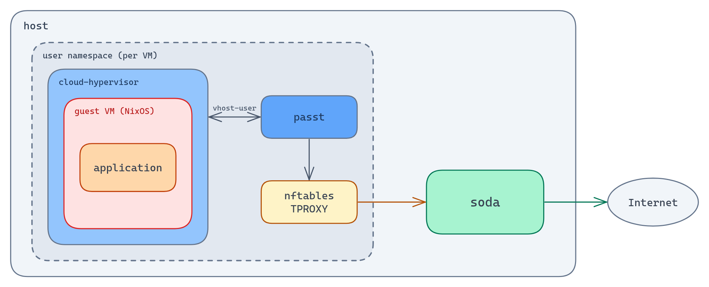
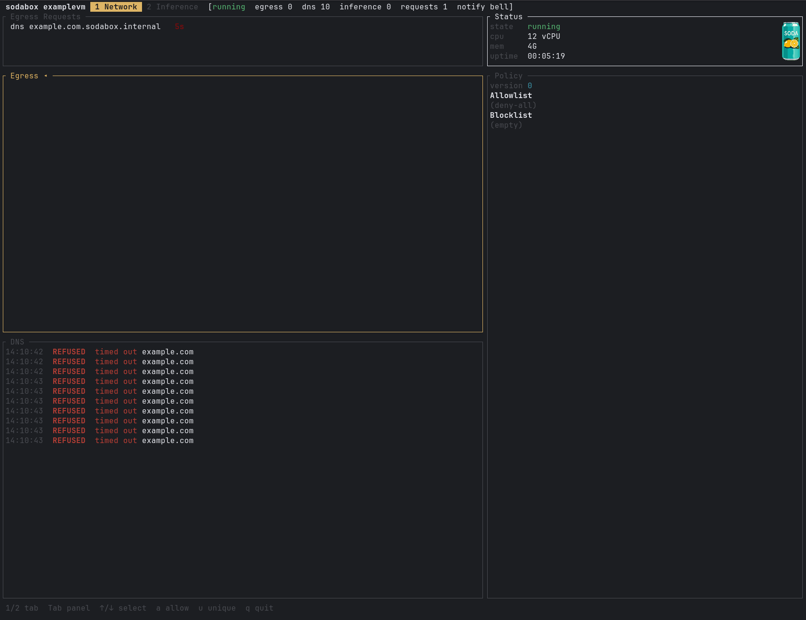

# sodabox


microVMs for agents, analyses and experiments powered by NixOS

- run multiple VMs on a single host
- fully filtered traffic egress using policies and profiles
- ssh access
- an inference gateway: LLM providers without API keys in the VM, with token quotas
- file transfer via rsync or git
- ephemeral, home-persisted or full-persisted VMs
- disk, memory and CPU cores are configurable
- user-space only, no need to change system configuration!

## Threat model

sodabox is created for coding agents but can be used to execute arbitrary untrusted applications.

Its threat model assumes that the whole guest system is untrusted and thus all network access
must be fully controlled by policies.
A sodabox VM has its own data disks. Data is copied into these disks and from them intentionally
as the VM itself is regarded untrusted. That way, a VM cannot, by accident, delete the content
of a folder that has been mounted using e.g. virtiofs.

A guiding idea is that the guest application itself can be run as `root` without compromising
the host.

## Requirements

* KVM enabled, available to your user (part of group `kvm`)
* Nix daemon installed
* User + Network Namespaces enabled
* for one running VM, 8GiB Disk and 2 GiB RAM

## Architecture

The architecture of sodabox tries to keep the trusted computing base (TCB) as minimal as possible.
Instead of trying to lock in applications using namespaces, seccomp, landlocks etc. it creates
a dedicated virtual machine around the Kernel-based Virtual Machine (KVM) using [Cloud Hypervisor](https://www.cloudhypervisor.org/).
Cloud Hypervisor has been chosen as it is written in the Rust language. It only has a limited amount
of device options, does not support emulation and in general does not have much legacy debt.
For networking, each VM gets its own [passt](https://passt.top/passt/about/) instance.
The hypervisor together with the passt instance is executed in a dedicated user networking namespace
from which traffic is routed out using `TPROXY` nftables commands to a final proxy (again, per VM)
running in the host. This combination makes sodabox a 100% user-space solution without needing
to modify the host (no tun/tap interfaces, `CAP_NET_ADMIN`, custom firewall chains)!



## Usage

### Check requirements

```
$ soda preflight
soda preflight — host prerequisites

[ ok ] KVM      /dev/kvm present and read/write
[ ok ] userns   unprivileged user + network namespaces work
[info] cloud-hypervisor found at /nix/store/gr6sc7kmn3px300rxh9z0b2x72gqbvvl-cloud-hypervisor-53.0/bin/cloud-hypervisor
[info] passt            found at /nix/store/dbnaxh8gphmb5pymv0593c29hrnhpzzx-passt-2026_07_16.090d739/bin/passt
[info] mkfs.erofs       found at /nix/store/asjwb24mfm7758yl7qmn44svfk0a2kaj-erofs-utils-1.9.4/bin/mkfs.erofs
[info] ssh-keygen       found at /nix/store/ggcm0s524bsly3qc7kww945qs7003psf-openssh-10.5p1/bin/ssh-keygen
[info] ssh              found at /nix/store/ggcm0s524bsly3qc7kww945qs7003psf-openssh-10.5p1/bin/ssh
[info] rsync            found at /nix/store/cnfiwpp8b21al55xsa07m5ca74fbdify-rsync-3.5.0/bin/rsync

[ ok ] all required checks passed.
```

### Creating a VM

First we create the VM

```
$ soda create --disk 8G --cpus 12 --mem 4G --persist home examplevm
using existing guest input at /home/max/.config/sodabox/shared
wrote /home/max/.config/sodabox/guests/examplevm/configuration.nix (imports the shared guest input)
guest for 'examplevm' -> /home/max/.config/sodabox/guests/examplevm
wrote /home/max/.local/share/sodabox/examplevm/meta.toml (ssh port 3530)
wrote /home/max/.local/share/sodabox/examplevm/policy.toml (deny-by-default)
provisioned /home/max/.local/share/sodabox/examplevm/home.img (1G, sparse)
created VM 'examplevm' (12 vCPU, 4G RAM, 8G scratch data + 1G kept home disk; persist = home).
```

You will find the guest NixOS config here:

```
~/.config/sodabox/guests/examplevm/configuration.nix
```

Use it to add packages and enable services for this VM only. For global settings,
edit `~/.config/sodabox/shared/configuration.nix`. Have a look at this file
if you want to use agents that ship with [llm-agents.nix](https://github.com/numtide/llm-agents.nix).

The resource limits of the VM can be found in its `meta.toml`. Should you want to
increase memory or vCPUs later, you can edit this file while the VM is stopped.
Lastly, the `policy.toml` contains all rules for network egress and filtering along
with the inference gateway settings.

In the example above, the VM only persists the `/root` directory of the VM. That allows
you to keep config files and application state but throw away all other state.
This makes it possible to create more VMs as each only takes max. ~ 1 GiB of storage
when stopped. They will only take more storage while running.

### Starting a VM

```
$ soda start examplevm --net
starting VM 'examplevm' in the background…
  …still starting (building the guest can take a while on first run)
VM 'examplevm' is up (supervisor pid 81227, 21s).
  ssh:  soda ssh examplevm
  stop: soda stop examplevm
  log:  /run/user/1000/sodabox/examplevm/supervisor.log
```

It makes sense to start the corresponding TUI immediately:

```
$ soda tui examplevm
```

Afterwards, ssh into the VM: `soda ssh examplevm`. The command automatically adds
the correct ssh identity. Inside the VM, try `curl https://example.com`. You will
see the egress attempts in the TUI. It also allows you to `allow` or `deny` them.



### Stopping a VM

```
$ soda stop examplevm
```

Depending on the persistence settings, this will delete the root disk or all disk,
leaving at least the configuration and policy.

### Removing a VM

```
$ soda rm examplevm
```

### Updating VMs

When creating a `sodabox` VM for the first time, it will copy the current `npins`
sources. After that you will need to update these yourself. This also allows you
to create completely custom NixOS guests instead of needing to live with opinionated
vendor settings.

In `~/.config/sodabox/shared` run

```
$ npins update nixpkgs
```
to update the nixpkgs source that is used for building all VMs.
Check out [npins](https://github.com/andir/npins) for more options.

## Inference gateway

A VM can use LLM providers without ever holding their API keys.

Define a provider once per host, in
`$XDG_CONFIG_HOME/sodabox/providers/<name>.toml`. It names where the key comes
from, never the key itself:

```toml
api = "mistral"                     # openai | mistral | ollama
base_url = "https://api.mistral.ai/v1"
auth = { command = ["pass", "show", "llm/mistral"] }
```

### Usage

Check it, and see which models it offers (this costs no tokens):

```sh
$ soda provider test mistral
```

Then, for a VM:

```sh
$ soda gateway enable --vm examplevm
$ soda allow service inference --vm examplevm        # lets the guest reach it
$ soda model add zai-glm-5-3 mistral/zai-glm-5-3 --vm examplevm
$ soda quota grant zai-glm-5-3 --vm examplevm 100k # or: soda quota unlimited big
$ soda quota show --vm examplevm
```

Inside the VM you can now query the inference API:

```
$ curl http://inference.sodabox.internal/v1/models
{"data":[{"created":0,"id":"zai-glm-5-3","object":"model","owned_by":"sodabox"}],"object":"list"}
```
Query it

```
curl http://inference.sodabox.internal/v1/chat/completions \
  -H "Content-Type: application/json" \
  -d '{
    "model": "zai-glm-5-3",
    "messages": [{"role": "user", "content": "Say hi"}],
    "stream": false
  }'
```

### Profile

To reuse a setup, put it in a profile
(`$XDG_CONFIG_HOME/sodabox/profiles/mistral-gw.toml`) and apply it with
`soda create vm2 --profiles mistral-gw` or `soda profile add mistral-gw`:

```toml
description = "Mistral through the inference gateway"

[gateway]
enabled = true

[[rules]]
kind = "service"
name = "inference"

[[models]]
alias = "big"
provider = "mistral"
model = "mistral-large-latest"
initial_quota = 1000000
```

### Guest config

In the guest, point clients at the gateway with any placeholder key:

```sh
export OPENAI_BASE_URL=http://inference.sodabox.internal/v1 OPENAI_API_KEY=sodabox
export OLLAMA_HOST=http://inference.sodabox.internal
```

The guest sees only its aliases (`big` above) and can't reach other models.
When a quota runs out, requests fail with an error that names the
`soda quota grant` command to run.

#### Pi model config

For pi, the config looks like this

```json
{
  "providers": {
    "mistral": {
      "baseUrl": "http://inference.sodabox.internal",
      "api": "openai",
      "apiKey": "sodabox"
    }
  }
}
```

or like this

```json
{
  "providers": {
    "localhost": {
      "baseUrl": "http://inference.sodabox.internal/v1",
      "api": "openai-completions",
      "apiKey": "sodabox",
      "models": [
        {
          "id": "qwen3.8:27b",
          "reasoning": true,
          "compat": {
            "supportsDeveloperRole": false,
            "supportsReasoningEffort": true,
            "thinkingFormat": "reasoning_effort"
          },
          "thinkingLevelMap": {
            "off": "none",
            "minimal": "low",
            "low": "low",
            "medium": "medium",
            "high": "high",
            "xhigh": "xhigh",
            "max": "max"
          }
        }
      ]
    }
  }
}
```
## Shell completion

The nix package installs completions for bash, zsh and fish. They complete
VM, profile and dotfile collection names as well as subcommands and flags.
Without the package, load them from your shell's startup file:

```sh
source <(COMPLETE=bash soda)   # ~/.bashrc
source <(COMPLETE=zsh soda)    # ~/.zshrc
COMPLETE=fish soda | source    # ~/.config/fish/config.fish
```

## Workflows

### rsync / file copy

Inside your project folder, do

```
$ soda sync-vm examplevm
sync-vm: pushing ./ -> root@127.0.0.1:/var/work/project/
```

to copy the whole folder to the vm. You may exclude parts using `--exclude`.

Once you are done, copy `/var/work/project` back to the host:

```
$ soda sync-host examplevm
sync-host: pulling root@127.0.0.1:/var/work/project/ -> ./  (host files may be overwritten)
2 path(s) would change:
    ./
    README.md
Pull? [a]ll / [i]nteractive / [N]o:
```

You can also copy individual files:

```
$ soda cp README.md examplevm:/tmp/.
```

### git

The best way to handle multiple versions of your project folder is to use native git.
For this, first set up a new remote that points to the VM using a `soda` helper.

```
soda git-remote examplevm
added remote 'examplevm' -> ext::soda git-proxy examplevm --user root %S
  now: git push examplevm <branch> (lands as host/<branch> in the VM; merge it there) / git pull examplevm
```

Once you push to this remote, your local repository will end up inside the VM at `/var/work/project`
under the `ref` namespace `host`.
To work on `main`, do `git checkout -b main host/main`.
When you commit inside the VM, fetch new commits into the host using `git fetch examplevm`. You can
then review these commits (e.g. `git show examplevm/main`) and merge / cherry-pick them.

## Influences

- https://github.com/finbarr/yolobox
- https://github.com/illustris/cogbox
- https://github.com/microvm-nix/microvm.nix

## License

MIT
