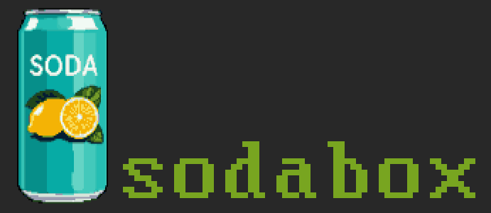

# sodabox



microVMs for agents, analyses and experiments powered by NixOS

- run multiple VMs on a single host
- fully filtered traffic egress using policies and profiles
- ssh access
- an inference gateway: LLM providers without API keys in the VM, with token quotas
- file transfer via rsync or git (virtiofs planned)
- emphermal, home-peristed or full-persisted VMs
- disk, memory and CPU cores are configurable

## Shell completion

The nix package installs completions for bash, zsh and fish. They complete
VM, profile and dotfile collection names as well as subcommands and flags.
Without the package, load them from your shell's startup file:

```sh
source <(COMPLETE=bash soda)   # ~/.bashrc
source <(COMPLETE=zsh soda)    # ~/.zshrc
COMPLETE=fish soda | source    # ~/.config/fish/config.fish
```

## Inference gateway

A VM can use LLM providers without ever holding their API keys.

Define a provider once per host, in
`$XDG_CONFIG_HOME/sodabox/providers/<name>.toml`. It names where the key comes
from, never the key itself:

```toml
api = "mistral"                     # openai | mistral | ollama
base_url = "https://api.mistral.ai/v1"
auth = { command = ["pass", "show", "llm/mistral"] }
```

Then, for a VM:

```sh
soda gateway enable --vm vm1
soda allow service inference --vm vm1        # lets the guest reach it
soda model add big mistral/mistral-large-latest --vm vm1
soda quota grant big 2M --vm vm1             # or: soda quota unlimited big
soda quota show --vm vm1
```

In the guest, point clients at the gateway with any placeholder key:

```sh
export OPENAI_BASE_URL=http://inference.sodabox.internal/v1 OPENAI_API_KEY=sodabox
export OLLAMA_HOST=http://inference.sodabox.internal
```

The guest sees only its aliases (`big` above) and can't reach other models.
When a quota runs out, requests fail with an error that names the
`soda quota grant` command to run.

## Architecture

TODO

## Workflows

TODO

## Influences

- https://github.com/finbarr/yolobox
- https://github.com/illustris/cogbox

## License

MIT
